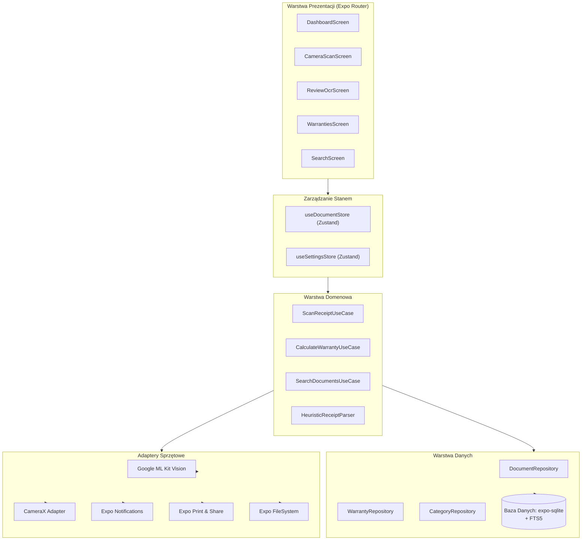
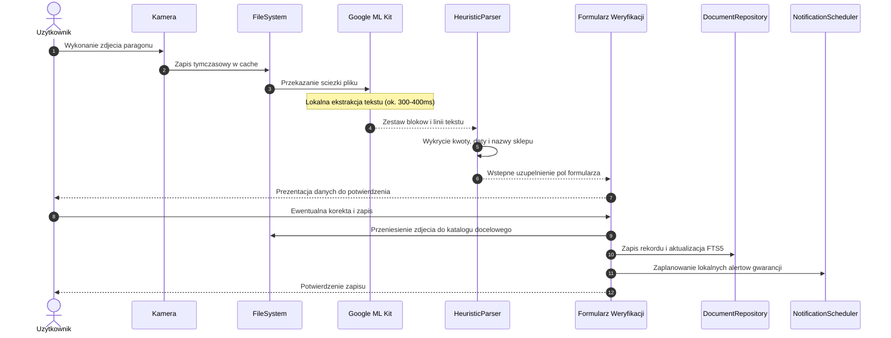
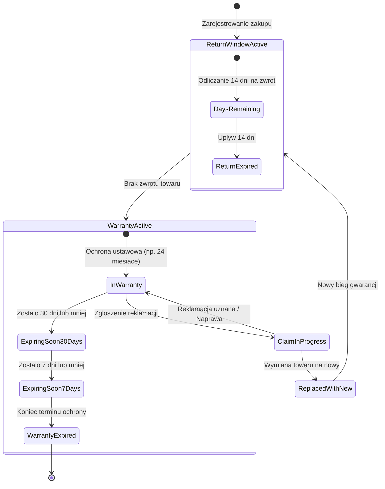
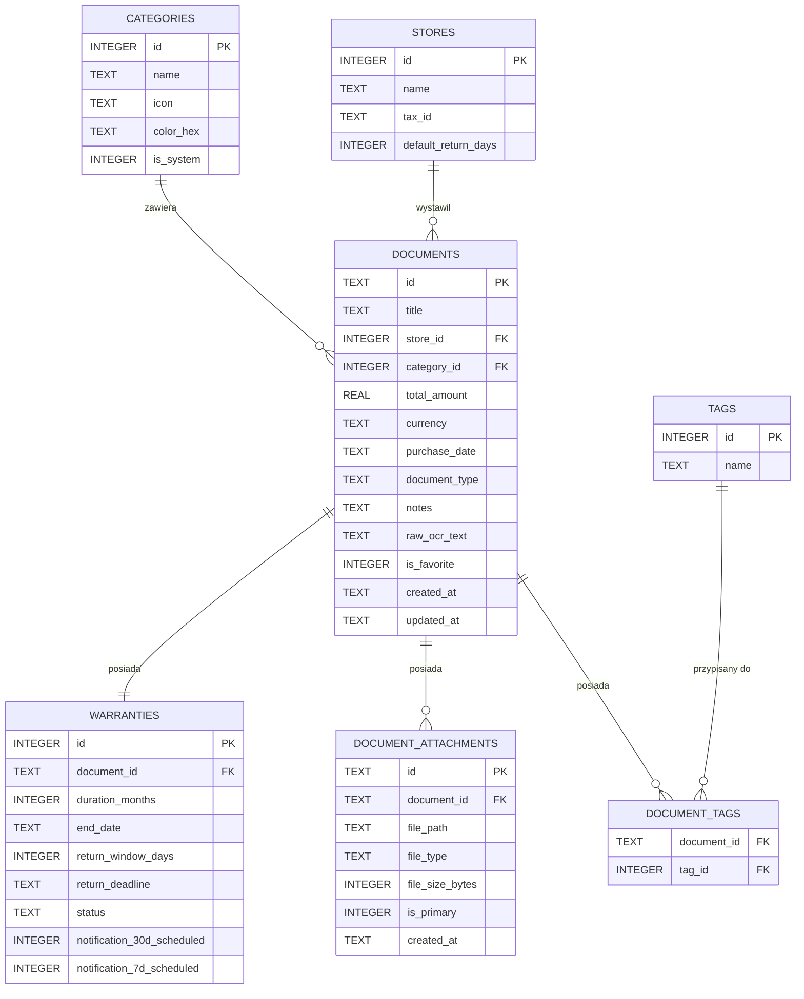

# Diagramy Systemowe

Wizualizacje architektury, przepływu danych oraz schematu bazy danych.

## 1. Architektura warstwowa

## 2. Sekwencja skanowania i przetwarzania OCR

## 3. Cykl życia gwarancji

## 4. Schemat relacji bazy danych (ERD)

